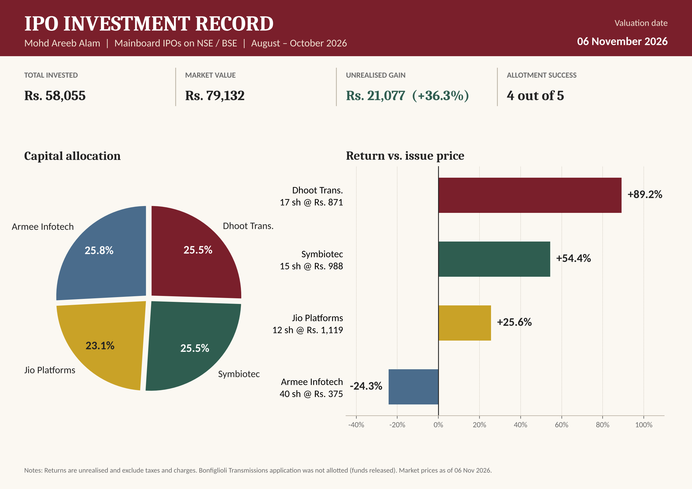
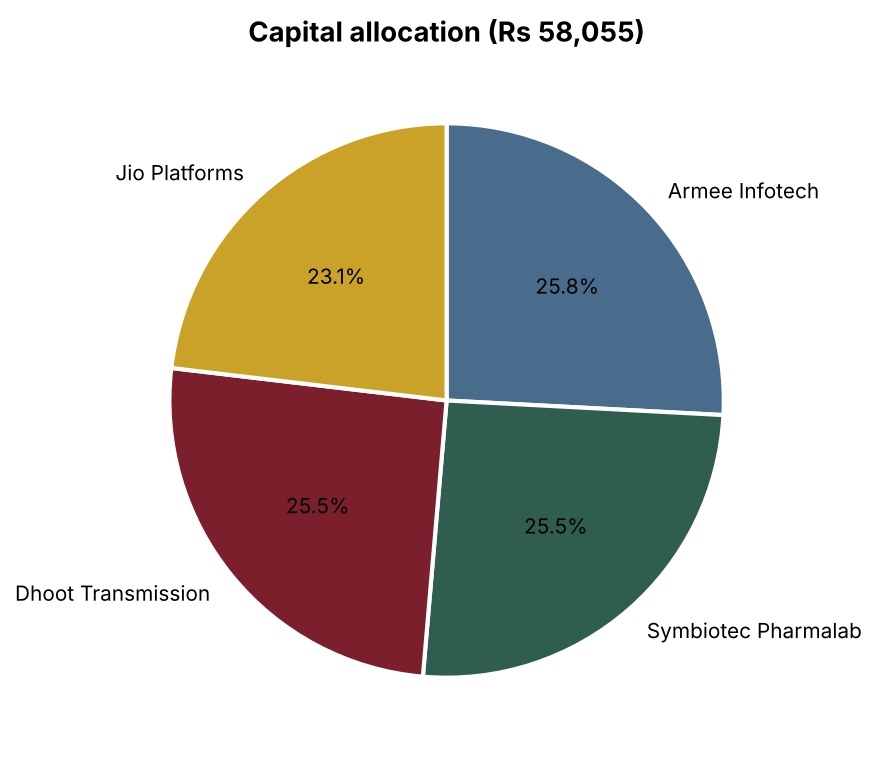
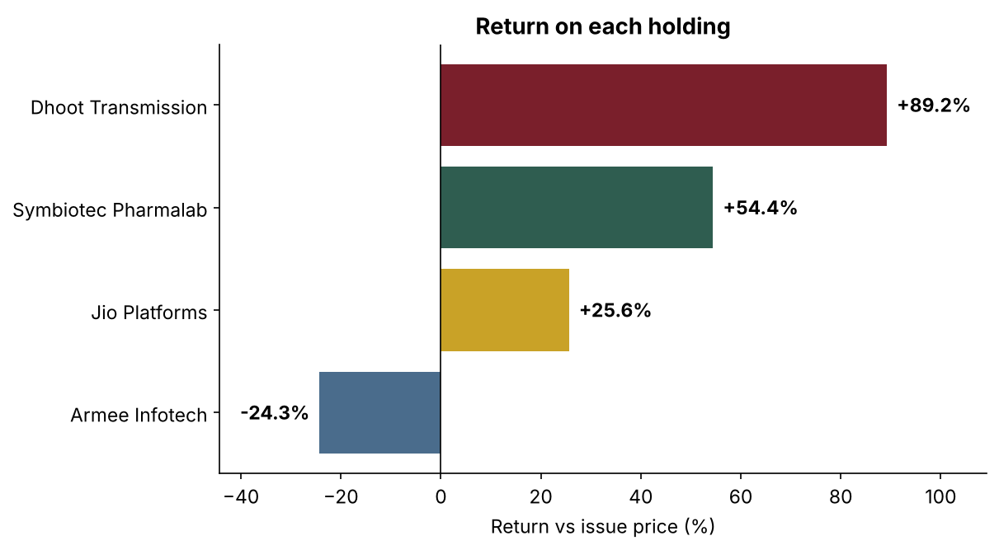
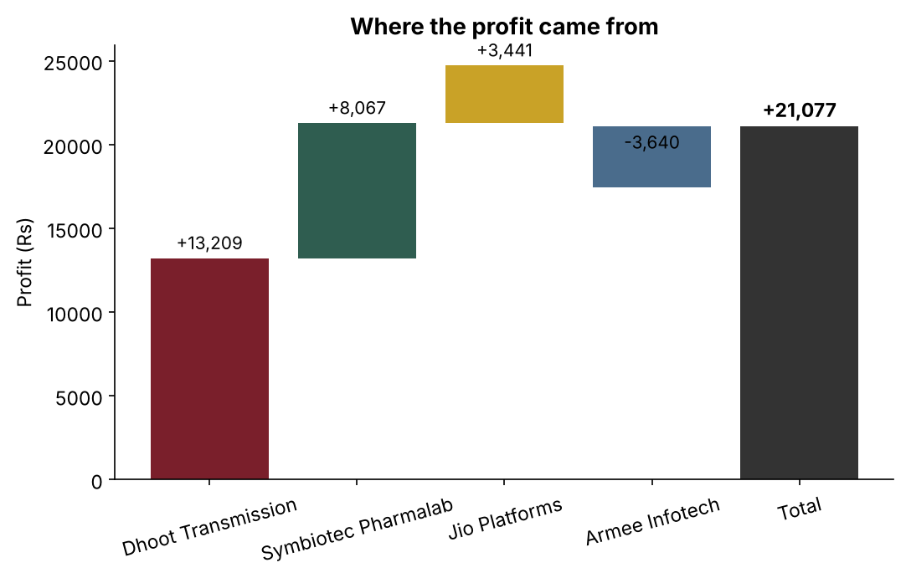
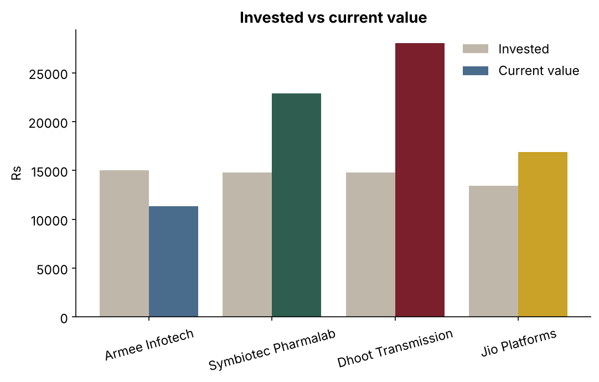
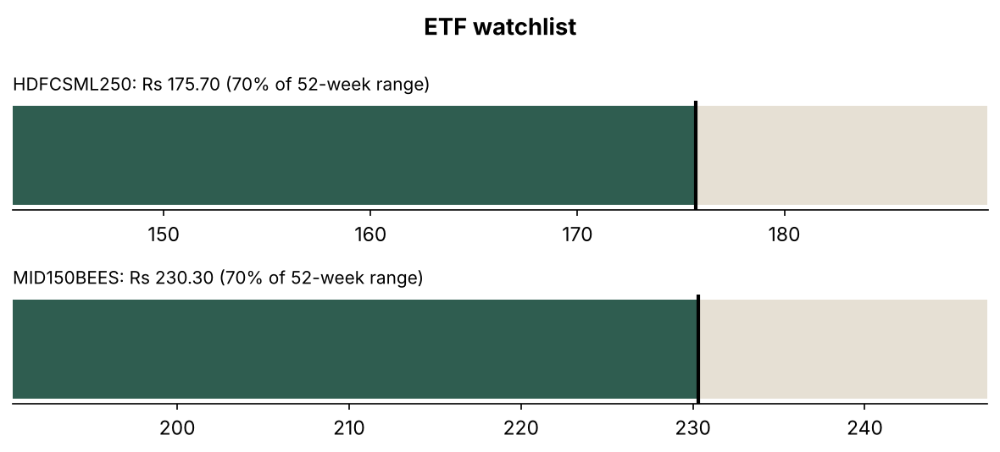

# IPO Portfolio Analysis

Tracking and analysing my own investments in Indian mainboard IPOs (Aug–Oct 2026) with **Python, SQL and data visualisation**.

I applied to five IPOs with my own savings, was allotted shares in four, and built this project to measure what worked, what didn't and why.



---

## Key results (prices as of 6 Nov 2026)

| Metric | Value |
|---|---|
| IPO applications | 5 |
| Allotments | 4 (80% success) |
| Capital invested | ₹58,055 |
| Current value | ₹79,132 |
| Unrealised profit | **₹21,077 (+36.3%)** |
| Holdings above issue price | 3 of 4 |
| Concentration (HHI) | 0.25, i.e. capital spread almost evenly |

| Holding | Shares | Issue ₹ | Price ₹ | Return | Profit ₹ | Days since listing |
|---|---|---|---|---|---|---|
| Dhoot Transmission | 17 | 871 | 1,648.00 | **+89.2%** | +13,209 | 81 |
| Symbiotec Pharmalab | 15 | 988 | 1,525.80 | **+54.4%** | +8,067 | 66 |
| Jio Platforms | 12 | 1,119 | 1,405.75 | **+25.6%** | +3,441 | 9 |
| Armee Infotech | 40 | 375 | 284.00 | **−24.3%** | −3,640 | 37 |

Bonfiglioli Transmissions (25 shares applied at ₹586) was not allotted, and the ₹14,650 was unblocked.

---

## How I chose which IPOs to apply for

Before each application I checked three things:

1. **Valuation:** is the price-to-earnings ratio reasonable compared with peers?
2. **Growth:** are revenue and profit actually growing in recent quarters?
3. **Demand:** how heavily was the issue subscribed, especially by institutional investors?

If an IPO failed this check, I skipped it.

## What the numbers taught me

- **Dhoot Transmission and Symbiotec** combined strong earnings growth with high demand, and together they made ₹21,276, slightly more than the whole portfolio's net gain.
- **Armee Infotech** looked cheap (P/E around 19), but its margins were thin and subscription was weak (about 2.4×). It is the only loss. *Cheap is not the same as good value.*
- **Equal-sized bets** (about ₹14–15K each) meant one loser could not sink the portfolio.
- **Next step:** diversify through index ETFs (Nifty Midcap 150 and Smallcap 250) instead of relying only on individual stocks.

---

## Charts

| | |
|---|---|
|  |  |
|  |  |

ETF watchlist (both ETFs sit about 70% of the way between their 52-week low and high):



---

## Project files

| File | What it is |
|---|---|
| `applications.csv` | 5 IPO applications: shares, issue price, allotment, listing date |
| `prices_2026-11-06.csv` | Market prices used for valuation, with sources |
| `etf_watchlist.csv` | ETFs being evaluated |
| `outlook.csv` | My qualitative outlook for each holding |
| `schema.sql` | Tables and the `v_holdings` view |
| `queries.sql` | 7 analysis queries |
| `analysis.py` | Builds the database, runs the queries, draws the charts, writes the report |
| `portfolio.db` | SQLite database (generated) |
| `1_…png` to `5_…png` | Charts (generated) |
| `portfolio_summary.md` | Full query results (generated) |
| `*_one_pager.png` | One-page summaries |

## SQL highlights

- A **view** (`v_holdings`) joins applications to the latest price and calculates cost, value, profit and holding days
- **Subqueries** for each holding's share of capital and of total profit
- **Conditional aggregation** for win rate and allotment success rate
- A **concentration measure** (Herfindahl index) to check diversification
- 52-week range positioning for the ETF watchlist

Full outputs: [`portfolio_summary.md`](portfolio_summary.md)

## How to run

```bash
pip install -r requirements.txt
python analysis.py
```

To update the portfolio, add a new file `prices_YYYY-MM-DD.csv` with the latest prices and run the script again. The analysis always uses the most recent price for each stock.

---

## Notes

- All returns are **unrealised** (no shares sold), measured against the issue price, and exclude taxes and brokerage.
- Prices are public closing prices on 6 Nov 2026; sources are listed in `prices_2026-11-06.csv`.
- Personal account details (DP ID, UPI ID, application numbers) are deliberately left out.
- This is a personal learning project, **not investment advice**.

---

**Mohd Areeb Alam** · B.Tech, NSUT (2027) · [LinkedIn](https://www.linkedin.com/in/mohd-areeb-alam-9ba28822a/) · [GitHub](https://github.com/areebalam49-lgtm)
